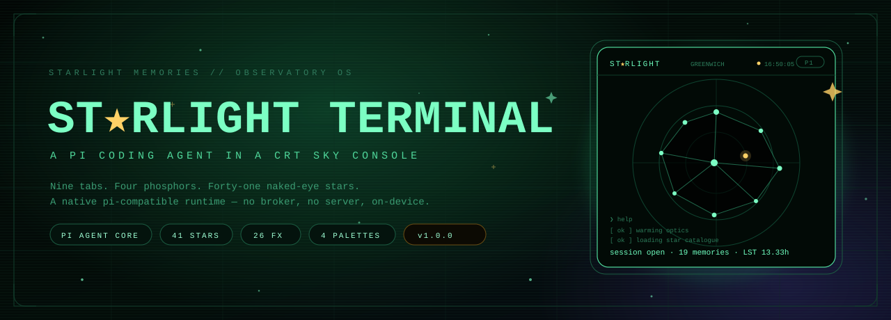
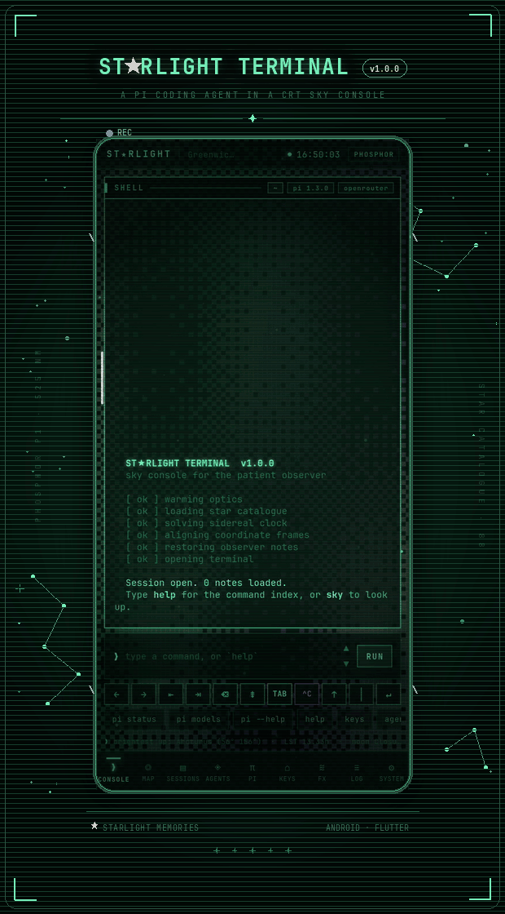
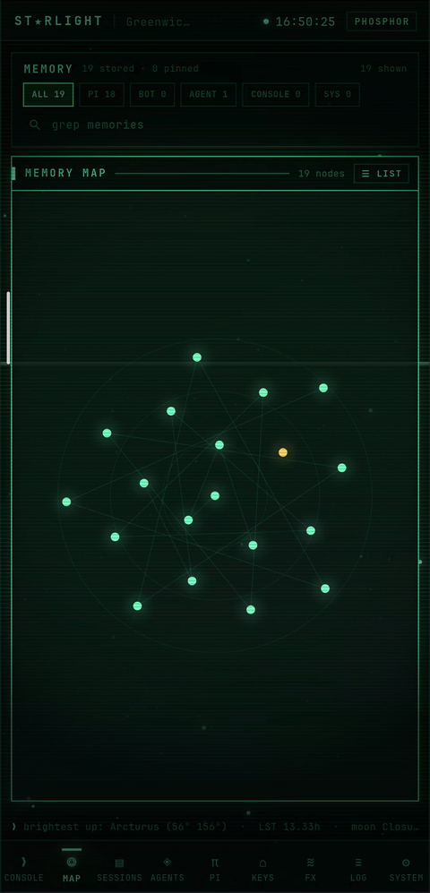
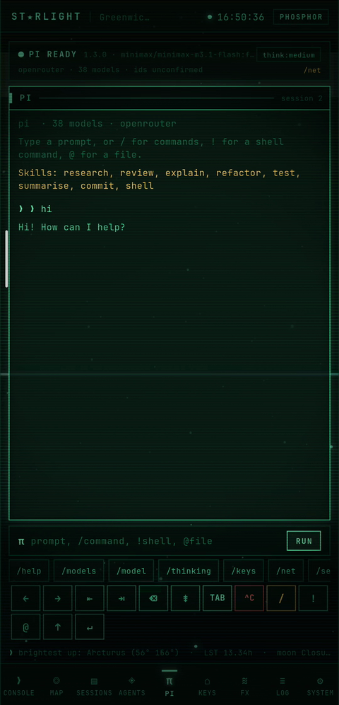
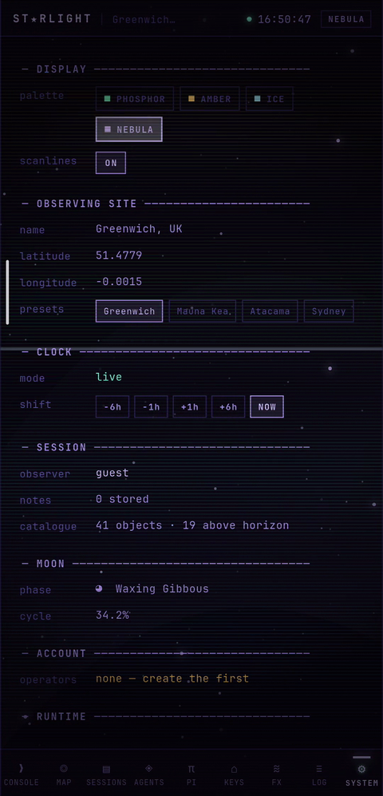
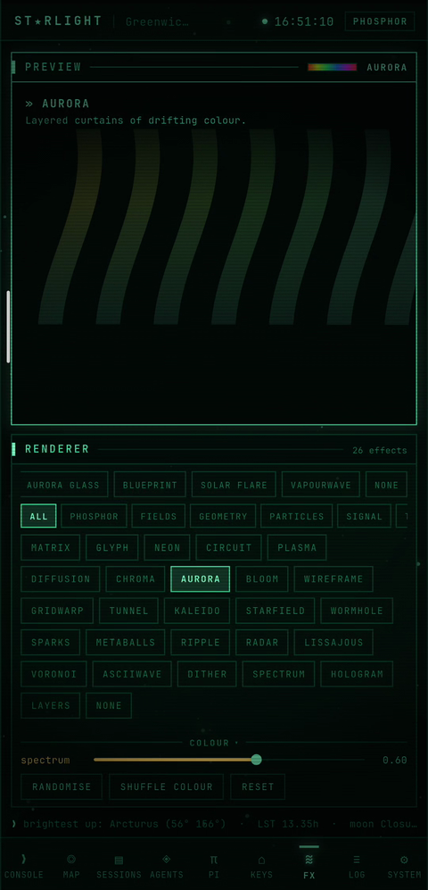
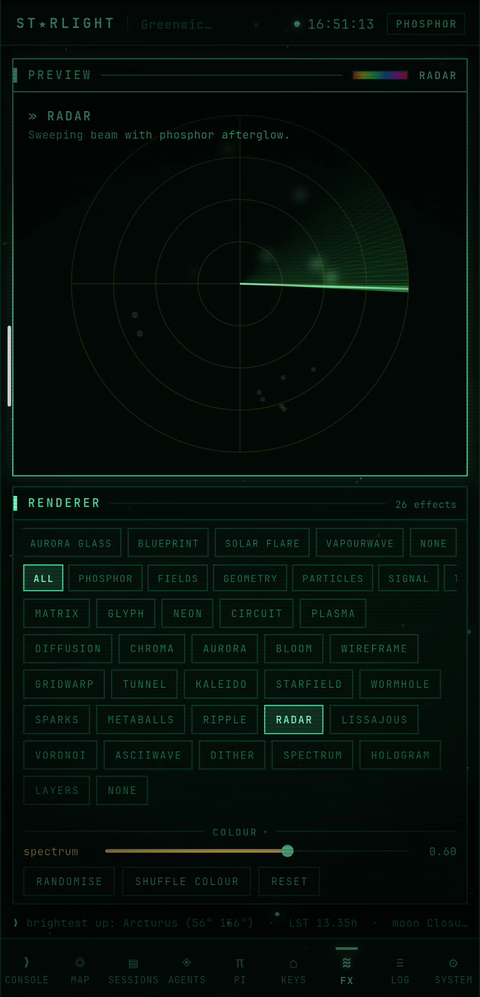
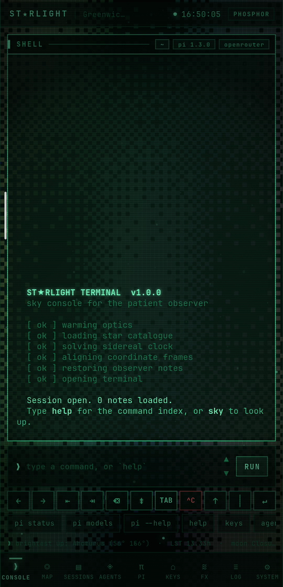
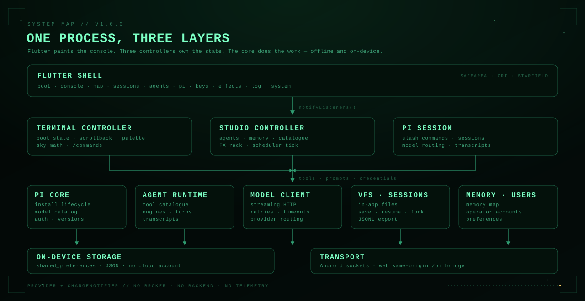
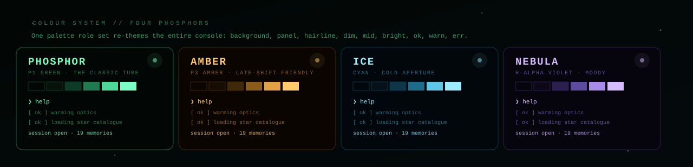

<div align="center">



<br>

<a href="https://github.com/Starlightmii/starlight-terminal/releases/latest"></a>
<a href="https://flutter.dev"></a>
<a href="https://github.com/Starlightmii/starlight-terminal/tree/main/test"></a>
<a href="https://github.com/Starlightmii/starlight-terminal/blob/main/LICENSE"></a>
<a href="#-the-agent-core"></a>

<br>

<sub>**Jaipur, Rajasthan · 2026** — a sky console that grew a brain.</sub>

</div>


## 🌠 What is Starlight Terminal?

**A CRT phosphor observatory that carries a real coding agent inside it.**

Boot it and you get scanlines, tube glow, four phosphor palettes, a sidereal clock, a
41-star naked-eye catalogue, moon phases, and a memory map that draws everything the
machine has learned as a constellation.

Underneath the glass it is a **pi-compatible agent runtime**: 17 provider presets, 36
slash commands, streaming model calls, craftable agents on a real scheduler, persistent
sessions, a virtual filesystem, and on-device memory. No broker. No backend. No telemetry.

> *It started as a sky-observation console. It kept growing until it was an agent platform
> that happens to be about the sky.*

<table>
  <tr>
    <td width="50%">🖥️ <b>CRT console</b><br><sub>Scrollback, <code>*emphasis*</code> markup, bloom, scanlines and a boot sequence that actually boots.</sub></td>
    <td width="50%">🧠 <b>Agent core</b><br><sub>pi command surface, model routing, skills, tools and streaming turns — natively in Dart.</sub></td>
  </tr>
  <tr>
    <td>🛰️ <b>Sky engine</b><br><sub>41 real stars, coordinate transforms, local sidereal time, moon phase and horizon visibility.</sub></td>
    <td>🎛️ <b>FX rack</b><br><sub>26 renderers over six families, with spectrum, hue, motion, bloom, warp and grain.</sub></td>
  </tr>
  <tr>
    <td>🗂️ <b>Sessions &amp; memory</b><br><sub>pi chats, bot runs, jobs, forks and JSONL export. Durable memories plotted on a map.</sub></td>
    <td>🔑 <b>Key vault</b><br><sub>LLM, image and video providers. Test, mask, rotate and route a key from the console.</sub></td>
  </tr>
</table>


## 📺 Demo

<p align="center">
  
</p>

<p align="center">
  <sub>24-second highlight · recorded on Android · <a href="https://github.com/Starlightmii/starlight-terminal/raw/main/docs/demo.gif">watch the full 84-second tour ↗</a></sub>
</p>

The full reel walks the boot log, the neon glyph rain, the session journal, the memory
map, a pi conversation, the settings frame, aurora, sparks, radar and the model catalogue.
Every frame is the real app, not a mockup.


## 🧭 The tour

| Tab | Emoji | What lives there |
|---|:---:|---|
| `CONSOLE` | ❯ | The terminal. Boot log, scrollback, sky commands, `/command` routing. |
| `MAP` | ◎ | Every durable memory as a node, coloured by source. Toggle to a searchable index. |
| `SESSIONS` | ▤ | pi sessions, bot runs and jobs. Search, select, pin, delete, inspect memories. |
| `AGENTS` | ◈ | Craftable agents: local or pi engines, AUTO/interval scheduler, standing task, RUN NOW. |
| `PI` | π | The agent chat surface: model picker, skills, command chips and transcript. |
| `KEYS` | ⌂ | Provider vault: 17 presets across LLM, image and video. Reveal, test, `USE FOR PI`. |
| `FX` | ≋ | 26 renderers — phosphor, fields, geometry, particles, signal and text. |
| `LOG` | ≡ | The event stream: severity, scope, filters and chronological export. |
| `SYSTEM` | ⚙ | Palette, scanlines, observing site, clock shift, session, moon, account, runtime. |

Plus the **BOOT** screen: palette selection, phosphor self-test and the first six warm-up
lines. The whole shell is one `Scaffold` with an effect stack, a starfield and a CRT
overlay above the pages.

<table align="center">
  <tr>
    <td align="center"><br><sub>🛰️ MAP — learned things as a constellation</sub></td>
    <td align="center"><br><sub>π PI — a real agent turn</sub></td>
    <td align="center"><br><sub>⚙ SYSTEM — palette, site, clock</sub></td>
  </tr>
  <tr>
    <td align="center"><br><sub>≋ FX — aurora curtains</sub></td>
    <td align="center"><br><sub>📡 FX — radar sweep</sub></td>
    <td align="center"><br><sub>🌅 BOOT — optics warm-up</sub></td>
  </tr>
</table>


## 🧠 The agent core

The app tracks the genuine **`@earendil-works/pi-coding-agent`** command surface. On
Android there is no Node runtime to host, so the core is implemented natively in Dart:
the commands, skills, sessions, tools and model routing all behave like pi, with no
subprocess and no broker.

On Flutter web there is no subprocess either, so a small local bridge can proxy the real
`pi` binary same-origin through `/pi/*` — no CORS, no hardcoded host.

### ⚡ Commands

36 slash commands, grouped exactly like upstream — models, sessions, sharing and runtime.

<details>
<summary><b>⌘ Open the command table</b></summary>

```text
/model  /models  /thinking  /scoped-models  /login  /logout  /settings  /keys
/new  /resume  /name  /session  /tree  /fork  /clone  /compact  /context
/copy  /export  /share
/skills  /skill  /reload  /hotkeys  /changelog  /install  /net  /commands
/version  /update  /status  /debug  /bug  /help  /clear  /quit
```

</details>

### 🔌 Providers

Model entries are provider-driven, never hardcoded. Every entry carries the vault provider
that pays for it, so a model is only useful when you know **which key funds the turn**.

```dart
PiModelEntry(
  id: 'anthropic/claude-sonnet-4-5',
  vendor: 'Anthropic',
  context: 200000,
  reasoning: true,
  providerId: 'openrouter', // which credential pays
  free: false,
);
```

The vault ships 17 presets — OpenAI, Anthropic, Groq, OpenRouter, DeepSeek, Mistral,
Together, Ollama, Gemini, Z.ai, plus image and video endpoints. Keys live in
`shared_preferences`, never in source. The UI masks them, the model catalogue can be
refreshed from the live `/models` endpoint, and placeholder keys are rejected.
This is local convenience, not a hardware vault — treat the device accordingly.

### 🛰️ Sky, sessions and memory

- **Sky maths** — equatorial → horizontal transforms, local sidereal time, moon phase,
  altitude/azimuth, horizon filtering.
- **Sessions** — pi, bot and job transcripts with counters, pinning, capacity eviction,
  resume, fork, clone, compact and JSONL export.
- **Memory** — flat, JSON-safe, deduplicated memories with sources, tags, star anchors
  and a weight for eviction. The MAP draws the graph; the LIST gives every node a target.
- **Agents** — each agent has an engine (`local` or `pi`), a model, a transcript, a
  standing task, an interval and an AUTO arm. One fleet ticker drives all of them.
- **VFS** — an in-app filesystem so `ls`, `cat`, `write` and skill files work offline.


## 🧩 Architecture

<p align="center">
  
</p>

State is `provider` + `ChangeNotifier`. Three controllers drive everything:

| Controller | Owns |
|---|---|
| `TerminalController` | boot state, console buffer, palette, sky maths, `/commands` |
| `StudioController` | agents, memory, catalogue, sessions, FX, scheduler tick |
| `PiSession` | pi commands, model routing, streaming turns, transcripts |

```text
lib/
├── main.dart                    entry — installs the HTTP bridge, runs the app
├── core/
│   ├── pi_core.dart             pi install lifecycle, model catalog, auth
│   ├── pi_commands.dart         the 36-command table and skills
│   ├── providers.dart           provider presets and routing
│   ├── model_client.dart        direct streaming model client
│   ├── agent_runtime.dart       tool catalogue, turns, engines, transcripts
│   ├── agent_scheduler.dart     one ticker for the whole fleet
│   ├── vfs.dart                 in-app virtual filesystem
│   ├── session_store.dart       pi / bot / job sessions
│   ├── memory.dart              durable memory + map
│   ├── users.dart               salted local operator accounts
│   ├── catalogue.dart           41 naked-eye stars and sky maths
│   ├── console_engine.dart      lines, tones, markup
│   ├── effects.dart             26 FX painters
│   └── palette.dart             four phosphor palettes
├── state/                       the three controllers
└── ui/                          shell, chrome, screens, widgets
```


## 🎨 Four phosphors

<p align="center">
  
</p>

| Palette | Vibe | Bright |
|---|---|---|
| 🟢 **PHOSPHOR** | P1 green — the classic observatory tube | `#7CFFC4` |
| 🟠 **AMBER** | P3 amber — warm, low-fatigue, late-shift friendly | `#FFCB6B` |
| 🔵 **ICE** | Cyan phosphor — cold aperture, deep field | `#9DEBFF` |
| 🟣 **NEBULA** | Violet phosphor — hydrogen-alpha, moody | `#D6BCFF` |

Each palette is a complete role set — background, panel, hairline, dim, mid, bright,
ok, warn, err — so the entire app re-themes at once. The shell's effect canvas, starfield,
chrome, terminal and FX rack all read from the same palette object.


## 🚀 Install

<p align="center">
  <a href="https://github.com/Starlightmii/starlight-terminal/releases/latest">
    
  </a>
</p>

**Android APK** — universal, `arm64-v8a` / `armeabi-v7a` / `x86_64`.

| | |
|---|---|
| 📦 Package | `com.starlightterminal.stars` |
| 🏷️ Version | `1.0.0` |
| 🔐 Permissions | `INTERNET`, `ACCESS_NETWORK_STATE` |
| 🌐 Cleartext | enabled (for local Ollama and LAN gateways) |
| 🧾 License | MIT |

Grab the latest build from the [Releases page](https://github.com/Starlightmii/starlight-terminal/releases/latest).
The APK is built from this tree; the `Release/` folder is gitignored on purpose.


## 🛠️ Build it yourself

```bash
flutter pub get
flutter run                      # dev
flutter build apk --release      # Android
flutter run -d chrome            # web
```

### 🧪 Tests

```bash
flutter test
```

93 tests across four suites: sky maths and markup, the provider vault, agent tools, FX
parameters, memory/session stores, the scheduler, the app log and the pi command surface.

### 🌐 Web bridge (optional)

Flutter web cannot spawn subprocesses. To let the PI screen talk to the real `pi` binary,
run the bridge and the same-origin proxy:

```bash
flutter build web
python3 serve.py 5060             # static build + /pi/* → 127.0.0.1:5077
node /home/user/pi-bridge/server.mjs   # the real pi bridge, port 5077
```

`serve.py` streams response bodies chunk-by-chunk, so model deltas reach the browser as
they arrive instead of after the turn finishes. The app uses the same-origin `/pi/*` path;
there is no CORS and no hardcoded host.

### 🧷 Notes

- Keys and operator records are stored in `shared_preferences` as JSON. Passwords are
  salted SHA-256; this protects against a casual unlocked-device look, not a determined
  attacker with the device image.
- The app ships no analytics, crash reporter, ad SDK or remote config.
- `CatalogueScreen` is kept as a code mirror of the `find` command; the SESSIONS tab is
  the browsable catalogue now.


## 📜 License

MIT © 2026 **Starlight Memories** · Jaipur, Rajasthan

See [LICENSE](LICENSE) for the full text.

<br>

<div align="center">
  
</div>
